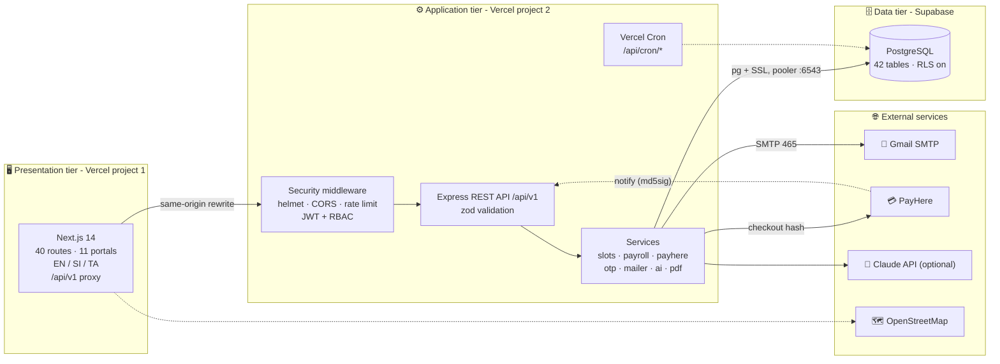
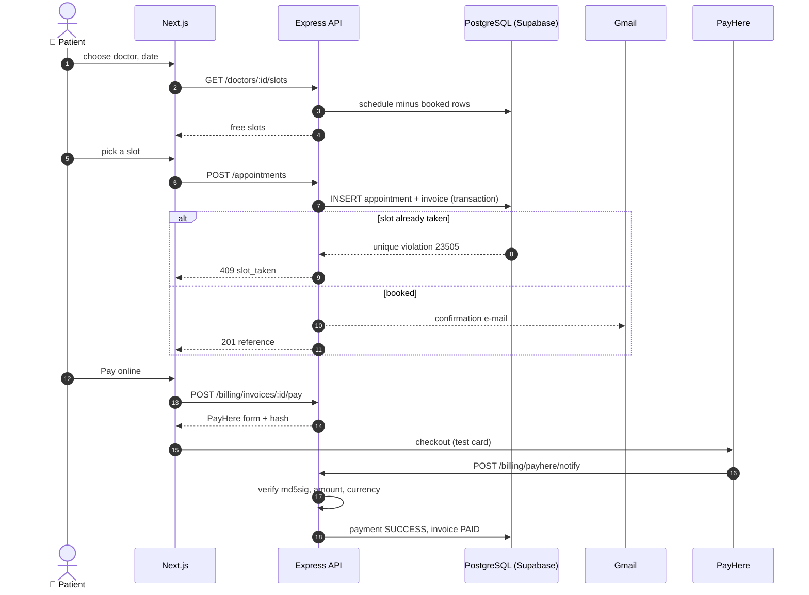
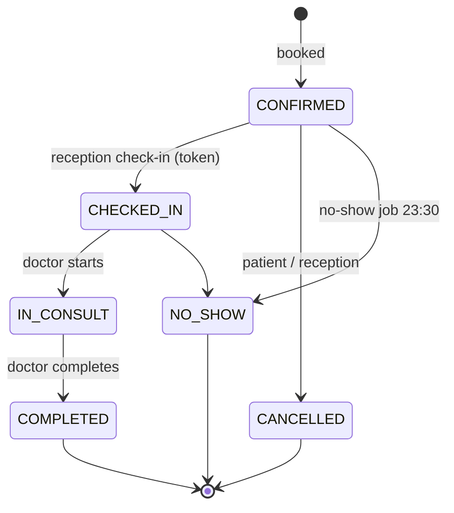
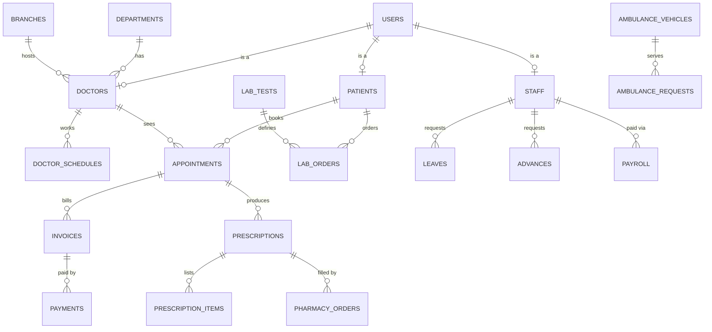
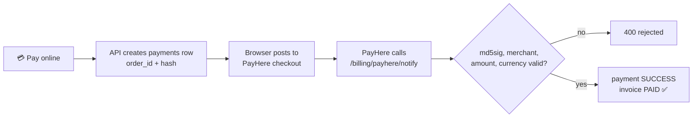
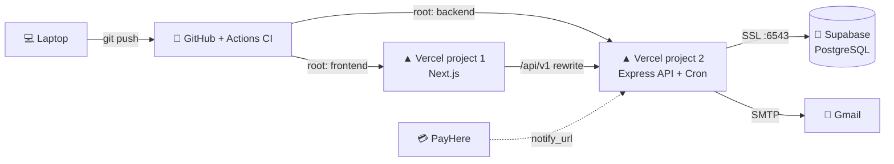

<div align="center">

# 🏥 RH Hospital Management System

### *Care Today… Healthier Tomorrow* 💙

**A full-stack, trilingual hospital platform — public website, patient services and 11 role-based staff portals — built with Next.js, Express, PostgreSQL (Supabase) and Vercel.**

<br/>


[🚀 Quick start](#-quick-start) · [✨ Features](#-features) · [🏗️ Architecture](#️-architecture) · [🔐 Security](#-security) · [📧 E-mail](#-real-e-mail-otp-with-gmail) · [💳 Payments](#-payments-with-payhere) · [🧪 Tests](#-testing) · [☁️ Deploy](#️-deployment) · [🛠️ Troubleshooting](#️-troubleshooting)

</div>

---

## 📖 Table of contents

1. [🌟 Overview](#-overview)
2. [📊 At a glance](#-at-a-glance)
3. [✨ Features](#-features)
4. [👥 Roles and portals](#-roles-and-portals)
5. [🏗️ Architecture](#️-architecture)
6. [🔄 Key flows](#-key-flows)
7. [🗄️ Database](#️-database)
8. [🧰 Tech stack](#-tech-stack)
9. [📁 Project structure](#-project-structure)
10. [🚀 Quick start](#-quick-start)
11. [⚙️ Configuration](#️-configuration)
12. [🔑 Demo accounts](#-demo-accounts)
13. [📧 Real e-mail OTP with Gmail](#-real-e-mail-otp-with-gmail)
14. [💳 Payments with PayHere](#-payments-with-payhere)
15. [🤖 AI assistant and safety](#-ai-assistant-and-safety)
16. [🔐 Security](#-security)
17. [🔌 API overview](#-api-overview)
18. [🧪 Testing](#-testing)
19. [☁️ Deployment](#️-deployment)
20. [🛠️ Troubleshooting](#️-troubleshooting)
21. [🗺️ Project status and roadmap](#️-project-status-and-roadmap)
22. [🙏 Credits and notes](#-credits-and-notes)

---

## 🌟 Overview

**RH HMS** replaces paper registers, phone calls and disconnected spreadsheets with **one connected platform** for a four-branch hospital group (Colombo, Kandy, Galle, Jaffna).

| 🌐 Public website | 🧑‍⚕️ Patient services | 🏢 Staff operations |
|---|---|---|
| Services, departments, doctors, packages, lab tests, news, FAQs, careers, reviews, branches — in **English, සිංහල and தமிழ்** | Register with an **e-mail OTP**, book **real slots** (in person or video), pay online, download prescriptions, QR health card, order medicines | **11 role portals** with live data and working buttons: check-in, prescribe, lab results, pharmacy stages, dispatch, payroll, content management |

> 💡 **Every page reads from the database** through a REST API. If the API is offline, the public pages fall back to built-in sample data so the site never looks broken.

---

## 📊 At a glance

| 🖥️ Front-end routes | 🔌 REST endpoints | 🗄️ PostgreSQL tables | 👥 Roles | 🌍 Languages | ✅ Unit tests |
|:-:|:-:|:-:|:-:|:-:|:-:|
| **40** | **~150** | **42** | **11** | **3** | **37 unit + 11 API** |

---

## ✨ Features

### 🌐 Public website
- 🏠 Home with hero, announcement bar, promotions and reviews
- 🩺 Doctor finder — filter by department, branch, language, video support and name
- 🏥 Departments, centres of excellence, services, resident consultants
- 🧪 Laboratory catalogue and 🎁 health packages with prices
- 🛏️ Rooms, 🅿️ parking, bed capacity board, opening hours — **auto-refreshing every 30 s**
- 📰 News, ❓ FAQs, 🏆 awards, 📑 reports, 🏛️ directors, 📜 policies, 🖼️ gallery, 🍽️ canteen
- 💼 Careers with applications, ⭐ moderated reviews, 📍 branches with map, 💬 WhatsApp button
- 🚨 Emergency page and 🚑 ambulance request with **live tracking** and ETA
- 🌍 International patients enquiry form
- 🌐 **English / Sinhala / Tamil** language switch, 📱 mobile-first responsive design, ✨ Framer Motion animations (respects *reduced motion*)

### 🧑‍⚕️ Patient portal
- 🔐 Sign-up with strength rules and **6-digit e-mail OTP**, secure login, silent session refresh
- 📅 **Smart booking wizard** — live slots from doctor schedules, earliest-slot hint, in-person or video (unique Jitsi room)
- 🛡️ **No double booking, ever** — enforced by the database, not just the UI
- 💳 Pay invoices online with **PayHere sandbox**
- 📋 Records: appointments, prescriptions (**PDF download**), lab results, invoices
- 🪪 **QR health card** — scan shows only blood group, allergies and emergency contact
- 💊 Order medicines by prescription number — pickup or delivery with live status
- 🤖 AI symptom checker and AI Doc chat with **emergency red-flag detection**

### 🏢 Operations (11 portals)
- 🧾 **Reception:** check-in → queue token, cancel, counter payments
- 👨‍⚕️ **Doctor:** own queue, start/complete consultation, prescribe, order lab tests
- 🩸 **Laboratory:** collect sample → process → enter result
- 💊 **Pharmacy:** order stages, stock adjust, add items, low-stock alerts
- 🛏️ **Nurse:** live bed board
- 🚑 **Ambulance:** dispatch, status updates, GPS sharing
- 👥 **HR:** staff, leave and advance approvals, **automatic EPF/ETF payroll**, job applications
- 💰 **Finance:** invoices, payments, salaries, revenue chart
- 📝 **Branch / Super admin:** news, announcements, review moderation, messages, doctors, users and roles, **audit log**, analytics
- 📺 **Public queue display** — token board for waiting rooms (no patient names)

### ⚙️ Platform
- 🔄 Live pages (queue board, ambulance tracking, pharmacy status, beds) **refresh by polling** every few seconds, which works on serverless Vercel
- ⏰ **Vercel Cron** jobs: appointment reminders, no-show marking, monthly payroll, clean-up (node-cron is used on an always-on server)
- 📧 Gmail SMTP e-mail · 💳 PayHere (sandbox / live) · 🧠 optional Claude AI · 🗺️ OpenStreetMap
- 🧪 Jest + Supertest tests · 🔁 GitHub Actions CI · ☁️ Supabase + Vercel (optional Docker for a local PostgreSQL)

---

## 👥 Roles and portals

| Role | Portal | What they can do |
|---|---|---|
| 🧑 Patient | `/portal/patient` | Book, cancel, pay, records, PDF, profile, join video |
| 👨‍⚕️ Doctor | `/portal/doctor` | Queue, start/complete, prescribe, order lab |
| 🧾 Reception | `/portal/reception` | Check-in, cancel, counter payments |
| 🩺 Nurse | `/portal/nurse` | Bed board |
| 💊 Pharmacy | `/portal/pharmacy` | Orders, stock |
| 🔬 Laboratory | `/portal/laboratory` | Sample → result |
| 👥 HR | `/portal/hr` | Staff, leave, advances, payroll, applications |
| 💰 Finance | `/portal/finance` | Invoices, payments, salaries |
| 🚑 Ambulance | `/portal/ambulance` | Dispatch, status, GPS |
| 🏢 Branch admin | `/portal/branch-admin` | Website content, doctors, analytics |
| 🛡️ Super admin | `/portal/super-admin` | Everything + users, roles, audit log |

> 🔒 The **API enforces every role**. The portal only decides what to show; a patient calling an admin endpoint always gets `403`.

---

## 🏗️ Architecture

Three tiers, external services reached **only from the server** — secrets never reach the browser.



**Design principles:** 🎯 business rules live in small *pure functions* (slots, payroll, payment signatures) that are unit tested · 🛡️ database constraints are the last line of defence · 🔌 stateless API (fits serverless) · 🧱 layered code: routes → services → data.

---

## 🔄 Key flows

### 📅 Booking, e-mail and payment



### 🔁 Appointment lifecycle



### 🩺 Patient journey

`Book → Check-in & token → Queue board → Consultation → Prescription / Lab order → Pharmacy delivery → Invoice paid → Records & QR card`

### 🔐 Registration and OTP

`Register → bcrypt hash → 6-digit OTP (stored hashed) → Gmail e-mail → verify (10 min, 5 attempts) → JWT + refresh cookie → role dashboard`

---

## 🗄️ Database

**42 tables** (PostgreSQL on Supabase) in six groups — public content · identity and security · clinical · billing · operations · HR.



<details>
<summary>🧠 <b>Smart database rules</b> (click to expand)</summary>

| Rule | How PostgreSQL enforces it |
|---|---|
| 🚫 No double booking | **Partial unique index** `appt_slot_uq ON appointments (doctor_id, appt_date, appt_time) WHERE status <> 'CANCELLED'`: a cancelled slot can be re-booked, two live bookings cannot coexist |
| 🔢 One queue number per doctor per day | Next number computed in a transaction with the row locked (`FOR UPDATE`) |
| 💰 Safe payments | `payments.order_id` unique, `invoices.amount > 0`, idempotent notify handler, money in `NUMERIC(10,2)` |
| 🔒 Sensitive data minimised | OTPs and refresh tokens stored as **hashes**; QR holds a random token; no card data stored |
| 🛡️ Not exposed by Supabase | **Row Level Security is ON for all 42 tables, with no policies**: the public Supabase Data API (anon key) returns nothing. Only the API's server-side connection reads data |
| ✅ Valid data | `CHECK` constraints for statuses, roles, dates, ratings, stock |
| 🌐 Translations | `JSONB` columns hold `{ "en": "...", "si": "...", "ta": "..." }` |
| 🕒 Time | `TIMESTAMPTZ`, always UTC; "today" is calculated in `Asia/Colombo` |

</details>

---

## 🧰 Tech stack

| Layer | Technology |
|---|---|
| 🎨 **Front end** | Next.js 14 (App Router), React 18, TypeScript, Tailwind CSS, Framer Motion, Lucide icons, `qrcode.react` |
| ⚙️ **Back end** | Node.js 20, Express 4, `zod`, `helmet`, `cors`, `express-rate-limit`, `bcryptjs`, `jsonwebtoken`, `pdfkit`, `qrcode`, `node-cron` (local only) |
| 🗄️ **Database** | **PostgreSQL 15+ on Supabase** with `pg` (node-postgres), JSONB, partial unique indexes, Row Level Security |
| 🔄 **Live updates** | Short polling (5–30 s). Socket.IO code remains in `src/server.js` for an always-on server but is not used on Vercel |
| 📧 **E-mail** | Nodemailer + **Gmail SMTP** (App Password) |
| 💳 **Payments** | **PayHere** (sandbox or live) |
| 🤖 **AI (optional)** | Claude API with a rule-based fallback |
| 🧪 **Quality** | Jest, Supertest, GitHub Actions (PostgreSQL service container) |
| ☁️ **Hosting** | **Vercel** (front end and API as two projects) + **Supabase** (database) |

---

## 📁 Project structure

```text
rh-hospital-full/
├── 📂 frontend/                  Next.js 14 website + 11 portals  (Vercel project 1, root directory "frontend")
│   ├── app/                      routes: (site) public pages, (auth), portal/[role], queue-display
│   ├── components/               Header, Footer, AIChat, charts, shared UI
│   ├── lib/                      api.ts (token in memory, silent refresh) · live.tsx · portalLive.ts · data.ts · i18n/
│   ├── next.config.mjs           rewrites /api/v1/* to the API (same-origin cookies)
│   └── public/images/            photos and artwork
│
├── 📂 backend/                   Express REST API         (Vercel project 2, root directory "backend")
│   ├── index.js                  Vercel entry point (exports the Express app)
│   ├── vercel.json               Cron schedules (reminders, no-show, payroll, clean-up)
│   ├── src/
│   │   ├── app.js  server.js     app setup / local server (Socket.IO + node-cron only here)
│   │   ├── routes/               auth · public · appointments · queue · patients · clinical
│   │   │                         billing · pharmacy · ambulance · hr · admin · ai · cron
│   │   ├── services/             slots · payroll · payhere · otp · mailer · ai · pdf (pure + tested)
│   │   ├── middleware/           auth (JWT + RBAC) · error (PostgreSQL error codes) · audit
│   │   ├── jobs/cron.js          the scheduled jobs as plain functions
│   │   └── db.js  sqlutil.js     pg Pool, transactions, type parsers
│   ├── db/                       schema.sql (PostgreSQL) · setup.js · seed.js · seed-data.json
│   ├── tests/                    unit · api
│   ├── docs/                     api-examples.http · FRONTEND-INTEGRATION.md
│   ├── scripts/mail-test.js      test your Gmail settings
│   ├── Dockerfile  docker-compose.yml (local PostgreSQL)
│   └── .github/workflows/ci.yml
│
└── 📄 README.md                  you are here
```

---

## 🚀 Quick start

### ✅ Requirements
- 🟢 **Node.js 18+** (20 recommended) and npm
- 🐘 A **Supabase** project (free) — *or* a local PostgreSQL 13+ (`docker compose up -d db` in `backend/`)
- 🔀 Git

### 1️⃣ Database on Supabase (5 minutes)

1. <https://supabase.com> → **New project** → choose a strong **database password** (save it) and the nearest region.
2. Click **Connect** at the top of the project page and copy two strings:
   - **Transaction pooler** (port `6543`) → `DATABASE_URL` (used by the API, also on Vercel)
   - **Session pooler** (port `5432`) → `DATABASE_URL_SETUP` (used once to create the tables)
3. Replace `[YOUR-PASSWORD]` in both. If the password contains `@ / # : ?`, URL-encode it (`@` → `%40`).

> 💡 Use a **dedicated Supabase project** for RH HMS. The setup script creates tables with common names (`users`, `news`, `jobs`, …) in the `public` schema.

### 2️⃣ Backend (port 4000)

```bash
cd backend
npm install
cp .env.example .env          # Windows: copy .env.example .env   → fill DATABASE_URL and DATABASE_URL_SETUP
npm run db:setup              # creates 42 tables (RLS on) and the sample data
npm run dev                   # → http://localhost:4000/api/v1/health   →  {"status":"ok","db":"up"}
```

`npm run db:schema` = tables only · `npm run db:seed` = sample data only · `npm run db:reset` = **drop** the RH HMS tables and recreate them (asks nothing, deletes all data).
Prefer the browser? Paste `backend/db/schema.sql` into the Supabase **SQL Editor** and run it, then run `npm run db:seed`.

### 3️⃣ Frontend (port 3000)

```bash
cd frontend
npm install
cp .env.local.example .env.local     # Windows: copy .env.local.example .env.local
npm run dev                          # → http://localhost:3000
```

### 4️⃣ Try it in 2 minutes 🎬

1. 📝 Open `/register` → create an account → read the **6-digit code** (in your Gmail inbox, or in the *backend terminal* if `SMTP_HOST` is empty)
2. ✅ Verify → you land in the patient portal
3. 📅 Open `/appointments` → choose doctor **`d6`** (works every day) → book a slot → try the *same slot again* and see the `409`
4. 🧾 Log in as `reception@rhhospital.lk` → **Check in** the booking
5. 👨‍⚕️ Log in as `doctor1@rhhospital.lk` → **Start**, **Prescribe**, **Complete**
6. 📺 Open `/queue-display` to see the token board · 🧑 back as the patient: download the **prescription PDF**

> 🐘 **No Supabase yet?** `cd backend && docker compose up -d db`, then in `.env` leave `DATABASE_URL` empty and set `DB_HOST=localhost DB_USER=postgres DB_PASSWORD=rootpass DB_NAME=rh_hms`.

---

## ⚙️ Configuration

Copy `backend/.env.example` to `backend/.env`. **Never commit `.env` or real keys.** 🔑 On Vercel the same names go into *Project → Settings → Environment Variables*.

<details>
<summary>📋 <b>Backend environment variables</b> (click to expand)</summary>

| Variable | Purpose | Example / default |
|---|---|---|
| `NODE_ENV` | `development` or `production` (Vercel sets production) | `development` |
| `PORT` | API port (local only) | `4000` |
| `DATABASE_URL` | Supabase **Transaction pooler** string | `postgresql://postgres.<ref>:<pw>@aws-0-<region>.pooler.supabase.com:6543/postgres` |
| `DATABASE_URL_SETUP` | Supabase **Session pooler** string, used by `db:setup` only (optional) | `…pooler.supabase.com:5432/postgres` |
| `DB_HOST` `DB_PORT` `DB_USER` `DB_PASSWORD` `DB_NAME` | Local PostgreSQL instead of `DATABASE_URL` | `localhost` `5432` `postgres` … `rh_hms` |
| `DB_SSL` | Automatic: on for Supabase, off for localhost | *(empty)* |
| `DB_POOL_MAX` | Connections per function instance | `5` (production) |
| `JWT_ACCESS_SECRET` `JWT_REFRESH_SECRET` | Token signing keys — long and random | `node -e "console.log(require('crypto').randomBytes(48).toString('hex'))"` |
| `ACCESS_TTL` `REFRESH_DAYS` | Token lifetimes | `15m` · `7` |
| `CORS_ORIGINS` | Allowed front-end origins (comma separated, no trailing slash) | `https://rh-hospital.vercel.app` |
| `FRONTEND_URL` | Used in links and PayHere return URLs | `https://rh-hospital.vercel.app` |
| `SMTP_HOST` `SMTP_PORT` `SMTP_USER` `SMTP_PASS` | Gmail SMTP | `smtp.gmail.com` `465` `you@gmail.com` *(App Password)* |
| `MAIL_FROM` | Sender shown to the patient (Gmail uses your own address) | `"RH Hospital <you@gmail.com>"` |
| `PAYHERE_MERCHANT_ID` `PAYHERE_MERCHANT_SECRET` | PayHere credentials | *(from PayHere)* |
| `PAYHERE_SANDBOX` | `true` = test cards, `false` = live | `true` |
| `PUBLIC_API_URL` | Public **HTTPS** address of the API (PayHere calls it back) | `https://rh-hms-api.vercel.app` |
| `CRON_SECRET` | Protects `/api/cron/*` (Vercel sends it automatically) | long random text |
| `TRUST_PROXY` | Proxies in front of the API | `1` |
| `ANTHROPIC_API_KEY` `AI_MODEL` | Optional AI assistant | *(empty = local answers)* |
| `SEED_ADMIN_PASSWORD` `SEED_STAFF_PASSWORD` | Demo account passwords | `Admin@12345` · `Staff@12345` |

</details>

<details>
<summary>📋 <b>Front-end environment variables</b></summary>

| Variable | Purpose |
|---|---|
| `NEXT_PUBLIC_API_URL` | `/api/v1` on Vercel (proxied) · `http://localhost:4000/api/v1` locally |
| `BACKEND_URL` | Vercel address of the API project, e.g. `https://rh-hms-api.vercel.app` (needed **before the build**; empty locally) |
| `ANTHROPIC_API_KEY` `AI_MODEL` | Optional, server-side AI routes of Next.js |
| `NEXT_PUBLIC_WHATSAPP_NUMBER` | Number for the WhatsApp button |
| `NEXT_PUBLIC_HOTLINE` | Hotline shown in header and emergency page |

</details>

### 📜 Useful scripts

| Command (in `backend/`) | What it does |
|---|---|
| `npm run dev` | Start the API with auto-reload |
| `npm run db:setup` | Create the tables **and** the sample data (stops if the tables already exist) |
| `npm run db:schema` / `db:seed` | Tables only / sample data only |
| `npm run db:reset` | ⚠️ Drop and recreate the RH HMS tables |
| `npm test` · `npm run test:unit` | All tests · unit tests only |
| `npm run mail:test -- you@gmail.com` | Verify your Gmail settings and send a test e-mail |

---

## 🔑 Demo accounts

Created by `npm run db:setup`. **Change all passwords before any public deployment.** ⚠️

| Role | E-mail | Password |
|---|---|---|
| 🛡️ Super admin | `admin@rhhospital.lk` | `SEED_ADMIN_PASSWORD` (default `Admin@12345`) |
| 👨‍⚕️ Doctors (11) | `doctor1@rhhospital.lk` … `doctor11@rhhospital.lk` | `SEED_STAFF_PASSWORD` (default `Staff@12345`) |
| 🩺 Nurse | `nurse@rhhospital.lk` | same |
| 🧾 Reception | `reception@rhhospital.lk` | same |
| 💊 Pharmacy | `pharmacy@rhhospital.lk` | same |
| 🔬 Laboratory | `lab@rhhospital.lk` | same |
| 👥 HR | `hr@rhhospital.lk` | same |
| 💰 Finance | `finance@rhhospital.lk` | same |
| 🚑 Ambulance | `ambulance@rhhospital.lk` | same |
| 🏢 Branch admin | `branchadmin@rhhospital.lk` | same |
| 🧑 Patient | `patient@example.com` | same |

The seed also adds a demo appointment, invoice, prescription **`P-10001`**, lab order, pharmacy order, ambulance request, leave and advance so every portal has something to show.

---

## 📧 Real e-mail OTP with Gmail

OTP, password-reset, booking confirmation and reminder e-mails go through **Gmail SMTP** (about 500 e-mails per day for a normal Gmail account — enough for a project).

1. 🔐 Google Account → **Security** → turn on **2-Step Verification**
2. 🔑 Security → **App passwords** → create one named `RH HMS` → copy the **16 letters** (spaces do not matter)
3. 📝 In `backend/.env` (or the Vercel variables):

```ini
SMTP_HOST=smtp.gmail.com
SMTP_PORT=465
SMTP_USER=your-address@gmail.com
SMTP_PASS=<the 16-letter App Password>
MAIL_FROM="RH Hospital <your-address@gmail.com>"
```

4. 🧪 `npm run mail:test -- yourotheremail@gmail.com` → must print **Sent**
5. 🔁 Restart `npm run dev` → console shows **`[mail] SMTP ready`**

> 🚨 The App Password is a secret: never put it in `.env.example`, screenshots or Git. If it was exposed, delete it in your Google Account and create a new one.
> 💡 If sending fails, registration returns **HTTP 502 `mail_failed`** instead of silently waiting. With `SMTP_HOST` empty the code is only printed in the backend terminal (development).
> ⚠️ Gmail always shows your own address as sender. For a real hospital use a domain e-mail service (Brevo, Resend, SES) — only the `SMTP_*` values change.

---

## 💳 Payments with PayHere

The project uses the **real PayHere checkout**. In sandbox mode (default) test cards are used and **no real money moves**.



**Set-up**
1. Create a sandbox account at <https://sandbox.payhere.lk> → **Settings → Domains & Credentials** → note the **Merchant ID**.
2. **Add Domain/App** → enter your frontend domain (for example `rh-hospital.vercel.app`) → *Request to Allow* → copy the **Merchant Secret**. A Merchant Secret belongs to **one** domain, so add another entry (`127.0.0.1:3000` / `localhost`) if you also test locally and use that secret locally.
3. Set `PAYHERE_MERCHANT_ID`, `PAYHERE_MERCHANT_SECRET` and keep `PAYHERE_SANDBOX=true` in the **API** project on Vercel.
4. Set `PUBLIC_API_URL` to the **production domain** of the API project (`https://….vercel.app`) and `FRONTEND_URL` to the frontend domain. PayHere only calls **public HTTPS** addresses, so on a laptop **Pay online** answers *"PUBLIC_API_URL must be a public https address"* — test payments on the deployed site.
5. Pay with a PayHere **test card** (see the PayHere sandbox documentation) and watch the invoice turn **PAID** in the portal.

**Safety:** hash on checkout · `md5sig` verified with a timing-safe compare · amount and currency re-checked · duplicate notifications ignored (idempotent).

**Going live:** create a *live* merchant account (requires an approved business and domain), then set the live Merchant ID/Secret and `PAYHERE_SANDBOX=false`.

> ⚖️ Do not collect real money for a demonstration project.
> 🔓 Use the production domain, not a per-deployment preview URL, as `PUBLIC_API_URL`: Vercel *Deployment Protection* can block PayHere's callback on protected URLs.

---

## 🤖 AI assistant and safety

| 🧠 Feature | 🛡️ Safety rule |
|---|---|
| **AI symptom checker** returns urgency, department, general advice | Rule-based **red-flag detection** (EN / SI / TA) runs *before* any AI call — chest pain, breathing trouble, bleeding, stroke signs, self-harm → immediate **1990** emergency message |
| **AI Doc chat** answers hospital and booking questions | Never diagnoses, never gives drug doses; limited to hospital information and general health education |
| Optional **Claude API** | Key stays on the server; strict JSON validated; any error falls back to a safe **local answer** |

Without `ANTHROPIC_API_KEY` the built-in rule-based answers are used. No name, phone or NIC is sent to the AI service.

---

## 🔐 Security

| 🛡️ Control | Detail |
|---|---|
| 🔑 Passwords | **bcrypt** (cost 12), strength rules |
| 🎟️ Sessions | 15-minute **JWT** kept in memory + rotating **refresh token** (stored hashed, `httpOnly` cookie) |
| 🔢 OTP | Stored as hash · 10-minute expiry · locks after 5 wrong tries |
| 🚪 Lockout | 5 failed logins → account locked for 15 minutes; no user enumeration |
| 👮 Authorisation | Role check on **every** protected route + ownership checks (patients see only their own records) |
| ✅ Validation | `zod` on all input; **escaped placeholder** SQL parameters; column whitelist in the CMS helper |
| 🚦 Rate limits | General API · stricter on login, AI and public forms |
| 🧱 Headers / CORS | `helmet`; CORS limited to configured origins; 100 KB body limit |
| 🧾 Audit log | Logins and create / update / delete actions with user, time and IP |
| 🗄️ Database exposure | **Row Level Security** on all tables (Supabase Data API sees nothing); SSL connection; parameterised queries |
| ⏰ Cron | `/api/cron/*` accepts only `Authorization: Bearer <CRON_SECRET>` |
| 🤫 Secrets | Environment variables only; `.env` is git-ignored |

---

## 🔌 API overview

Base path: **`/api/v1`** · errors always look like `{ "error": { "code", "message", "details" } }`.

<details>
<summary>📚 <b>Endpoint summary</b> (click to expand)</summary>

| Module | Endpoints |
|---|---|
| 🔐 `auth` | `POST register · verify-otp · resend-otp · login · refresh · logout · change-password · forgot-password · reset-password` · `GET me` |
| 🌐 `public` | `GET branches · departments · services · lab-tests · packages · rooms · faqs · news · announcements · promotions · jobs · reviews · parking · opening-hours · content/:kind · operations/beds · operations/icu-beds · doctors (/:id, /:id/slots, /:id/earliest)` · `POST contact · careers/apply · reviews · room-bookings` |
| 📅 `appointments` | `POST /` · `GET /mine, /` · `PATCH /:id/cancel, /:id/status` · `POST /:id/check-in` |
| 📺 `queue` | `GET /:branch` |
| 🧑 `patients` | `GET /me, /me/records, /me/health-card, /health-card/:token` · `PUT /me` · `GET /` (search) |
| 🩺 `clinical` | `POST/GET /prescriptions` · `GET /prescriptions/:ref/pdf` · `POST/GET /lab/orders` · `PATCH /lab/orders/:id` |
| 💰 `billing` | `GET /invoices/mine, /invoices, /payments` · `POST /invoices, /invoices/:id/pay, /invoices/:id/mark-paid, /payhere/notify` |
| 💊 `pharmacy` | `POST /orders` · `GET /orders/track/:ref` · orders and items CRUD · `PATCH /items/:id/adjust` |
| 🚑 `ambulance` | `POST /requests` · `GET /track/:ref` · staff: requests, vehicles, `PATCH /requests/:id`, `POST /vehicles/:id/position` |
| 👥 `hr` | staff CRUD · leaves · advances · payroll (generate, list, mark paid) |
| 🏢 `admin` | CMS CRUD (news, announcements, promotions, faqs, packages, lab-tests, jobs, doctors, parking) · reviews · messages · applications · beds · users · audit-logs · analytics |
| 🤖 `ai` | `POST /chat · /symptom` |

📎 Ready-to-run examples: [`backend/docs/api-examples.http`](backend/docs/api-examples.http) (VS Code *REST Client*) · page-to-endpoint map: [`backend/docs/FRONTEND-INTEGRATION.md`](backend/docs/FRONTEND-INTEGRATION.md)

</details>

**Example — booking (and the conflict):**

```http
POST /api/v1/appointments
Authorization: Bearer <accessToken>

{ "doctorId": "d1", "date": "2026-11-16", "time": "09:15", "type": "VIDEO", "reason": "Follow-up" }
```
```json
// 201 Created
{ "id": "6f1c…", "ref": "RH-483920", "appt_time": "09:15:00", "status": "CONFIRMED", "doctor": "Dr. Anjali Perera" }

// 409 Conflict — same slot again
{ "error": { "code": "slot_taken", "message": "That time slot is no longer available" } }
```

---

## 🧪 Testing

```bash
cd backend
npm run test:unit      # 37 unit tests — no database needed
npm test               # + 11 API tests (no database); database-backed tests run when TEST_WITH_DB=1
```

| 🧪 Level | Tool | Covers |
|---|---|---|
| Unit | Jest | slots · payroll (EPF/ETF) · PayHere signatures · AI red flags · PostgreSQL helpers (types, timestamps, URL parsing) |
| API | Jest + Supertest | validation, 401/403/409/422, forged payment, cron protection, AI endpoint |
| Database flow | Jest + seeded DB | login, booking, double booking, **re-booking a cancelled slot**, cancel, role limits, malformed id → 400 |
| CI | GitHub Actions | runs everything against a PostgreSQL 16 service container on every push |

Database-backed tests need a **separate** PostgreSQL (a second Supabase project or local Docker), never your real data:
`DATABASE_URL=… npm run db:reset && npm run db:seed && TEST_WITH_DB=1 npm test` (set `SEED_*` passwords if you changed them).

---

## ☁️ Deployment

Two Vercel projects from **one GitHub repository** + one Supabase project.



### A. Database (Supabase)
Follow [Quick start step 1–2](#-quick-start): create the project, run `npm run db:setup` once from your laptop. In *Table Editor* you should see 42 tables, each marked **RLS enabled**.

### B. API (Vercel project 2)
1. Push the repository to GitHub (check that `.env` files are **not** in it).
2. Vercel → **Add New → Project** → import the repo → **Root Directory: `backend`** → Framework: *Express* / *Other* (auto-detected).
3. **Environment Variables** (Production): `NODE_ENV=production`, `DATABASE_URL` (Transaction pooler), `JWT_ACCESS_SECRET`, `JWT_REFRESH_SECRET`, `CORS_ORIGINS`, `FRONTEND_URL` (fill after step C — use a placeholder now), `SMTP_*` + `MAIL_FROM`, `PAYHERE_*`, `CRON_SECRET`, optional `ANTHROPIC_API_KEY`.
4. **Deploy**, then open `https://<api-project>.vercel.app/api/v1/health` → `{"status":"ok","db":"up"}`.
5. Set `PUBLIC_API_URL=https://<api-project>.vercel.app` and redeploy.
6. *Settings → Cron Jobs* lists the four jobs from `backend/vercel.json`. On the **Hobby** plan each job can run **once per day** and Vercel starts it somewhere inside the scheduled hour; the jobs are written to tolerate that.

| Cron job (UTC) | Sri Lanka time | Does |
|---|---|---|
| `/api/cron/reminders` 12:30 | ≈ 18:00 | e-mail reminders for tomorrow's appointments |
| `/api/cron/no-show` 20:30 | ≈ 02:00 | yesterday's unattended bookings → `NO_SHOW` |
| `/api/cron/payroll` 00:00 on the 1st | ≈ 05:30 | monthly salary run for the previous month |
| `/api/cron/cleanup` 21:30 | ≈ 03:00 | delete expired OTPs / tokens |

### C. Website (Vercel project 1)
1. **Add New → Project** → same repo → **Root Directory: `frontend`**.
2. Variables: `NEXT_PUBLIC_API_URL=/api/v1`, `BACKEND_URL=https://<api-project>.vercel.app`, `NEXT_PUBLIC_WHATSAPP_NUMBER`, `NEXT_PUBLIC_HOTLINE`, optional `ANTHROPIC_API_KEY`. **Deploy.**
3. Back in the **API** project set `CORS_ORIGINS` and `FRONTEND_URL` to `https://<frontend-project>.vercel.app` → **Redeploy**.
4. In PayHere add the frontend domain (see [Payments](#-payments-with-payhere)).

> 🍪 **Why the `/api/v1` rewrite?** The login refresh cookie must be a first-party cookie. With two different `*.vercel.app` sites it would be a third-party cookie and Safari/iPhone would drop it, logging users out on refresh. The rewrite makes the browser talk only to the website.

### D. Final check ✅
`/health` · register with a real Gmail address · book a slot · portal login · PayHere sandbox payment · open `/api/cron/cleanup` without a secret → must answer **401**.

> ⏱️ Rate limits and Socket.IO need an always-on server: limits are per function instance on Vercel (use Redis/Upstash for strict limits) and the live pages poll instead of using WebSockets.

---

## 🛠️ Troubleshooting

<details>
<summary>🐘 <b><code>password authentication failed</code> / <code>Tenant or user not found</code></b></summary>

- The pooler user name is **`postgres.<project-ref>`** (with the dot), not just `postgres`. Copy the string from *Connect* again.
- Wrong password → *Project Settings → Database → Reset database password*. URL-encode special characters (`@` → `%40`).
- Update **both** `.env` and the Vercel variable, then redeploy.

</details>

<details>
<summary>🌍 <b><code>ENOTFOUND db.xxxx.supabase.co</code> / <code>ENETUNREACH</code> (IPv6)</b></summary>

The *direct* connection (`db.<ref>.supabase.co`) is IPv6-only. Use the **Transaction pooler** (6543) or **Session pooler** (5432) string, which work over IPv4.

</details>

<details>
<summary>🔌 <b><code>/api/v1/health</code> shows <code>"db":"down"</code> on Vercel</b></summary>

Open the deployment *Logs*. Usually `DATABASE_URL` is missing (not set for *Production*), has `[YOUR-PASSWORD]` still in it, or points to port 5432 instead of 6543. Environment-variable changes need a **redeploy**.

</details>

<details>
<summary>🧱 <b><code>npm run db:setup</code> says tables already exist</b></summary>

Nothing was changed on purpose. `npm run db:reset` deletes the RH HMS tables and recreates them (all data lost). If the seed says "already in the database", run `db:reset`.

</details>

<details>
<summary>🛣️ <b>Every API route is 404 on Vercel</b></summary>

Check that the project's **Root Directory is `backend`**. If Vercel does not detect the Express app, create `backend/api/index.js` containing `module.exports = require('../src/app');` and add to `backend/vercel.json`: `"rewrites": [{ "source": "/(.*)", "destination": "/api" }]`.

</details>

<details>
<summary>📧 <b><code>[mail] SMTP login FAILED: 535</code> or <code>502 mail_failed</code></b></summary>

- `SMTP_PASS` must be a Google **App Password** (16 letters) — your normal Gmail password never works. 2-Step Verification must be on.
- `SMTP_USER` is the full Gmail address; keep `SMTP_PORT=465`.
- No quotes around values in the Vercel UI; **redeploy** after editing. Test with `npm run mail:test -- you@gmail.com`.
- Look in Spam the first time.

</details>

<details>
<summary>🌐 <b>CORS error in the browser</b></summary>

With the `/api/v1` rewrite there is no CORS at all. If you call the API directly, add the exact front-end origin (no trailing slash) to `CORS_ORIGINS` and redeploy the API.

</details>

<details>
<summary>🔄 <b>Logged out after refresh</b></summary>

Check that the website uses `NEXT_PUBLIC_API_URL=/api/v1` and that `BACKEND_URL` was set **before** the front-end build (rewrites are fixed at build time — redeploy after changing it). Also confirm `JWT_REFRESH_SECRET` did not change.

</details>

<details>
<summary>💳 <b>"PUBLIC_API_URL must be a public https address" / <code>payments_off</code></b></summary>

Set `PUBLIC_API_URL` to the API's `https://….vercel.app` production domain and add `PAYHERE_MERCHANT_ID` / `PAYHERE_MERCHANT_SECRET` (the secret created for the **frontend domain** in PayHere). A *hash mismatch / unauthorised domain* message from PayHere means the secret belongs to another domain.

</details>

<details>
<summary>⏰ <b>Cron job returns 401 or never runs</b></summary>

`CRON_SECRET` must exist in the API project (Production) — without it every cron call is rejected. Crons run only on the **production** deployment. On Hobby they run once a day.

</details>

<details>
<summary>🪟 <b>Windows commands</b></summary>

Use `copy .env.example .env` instead of `cp`. If `npm run dev` says the port is busy, stop the old process or change `PORT`.

</details>

---

## 🗺️ Project status and roadmap

The original plan listed **87 features**. Honest status of the finished system:

| ✅ Implemented | 🟡 Partial | 🔵 Designed only |
|:-:|:-:|:-:|
| **49** | **34** | **4** |

**🔵 Not built:** advertising module · theatre scheduling · emergency intake form · attendance and overtime.

**🟡 Partial (core works, extras planned):** reschedule and auto-release of bookings · video time-window check · file uploads (lab reports, CVs, annual reports) · pharmacy batches / FEFO · payslip PDFs · line-item invoices · package booking · branch switcher · PWA install · per-language URLs and SEO metadata.

**🚀 Ideas for the future:**
- 📱 SMS / WhatsApp notifications
- 🧾 PDF receipts and payslips by e-mail
- 🧠 Doctor-reviewed AI summaries
- 🔄 Redis / Upstash for shared rate limits and real-time (Supabase Realtime) instead of polling
- 🧪 Playwright end-to-end tests
- 🏥 HL7 / FHIR integration

---

## 🙏 Credits and notes

- 🎓 Built as a full-stack individual project for the **HND in Computer Science — Web Application Development** assessment.
- 🏷️ "RH Hospital", its doctors, branches and news are **fictional demonstration content**. Clinical and Sinhala/Tamil text must be reviewed by qualified people before any real use.
- ⚕️ The AI features give **general information only** and never replace a doctor. In an emergency call **1990 (Suwa Seriya)** or the hospital hotline.
- 🧰 Open-source libraries: Next.js, React, Tailwind CSS, Framer Motion, Lucide, Express, node-postgres (pg), zod, Nodemailer, pdfkit and others — see `package.json` files for licences.
- 🤖 AI tools were used to help prepare parts of the code and documentation. The author is responsible for reviewing, running and understanding all of it; acknowledge AI assistance as your institution requires.

<div align="center">

**Made with 💙 for better healthcare**

---

## 👨‍💻 ## Assignment

**Developed by: MOHANARAJ RISVIKA**  
🎓 HND in Computer Science Student  
🏫 [UPBRIGHT] | Stu ID: [UB004HNDCS]  
📧 GitHub: [@Rishas2006](https://github.com/Rishas2006)

*Submitted for: UB004CS Assignment 008*

</div>
